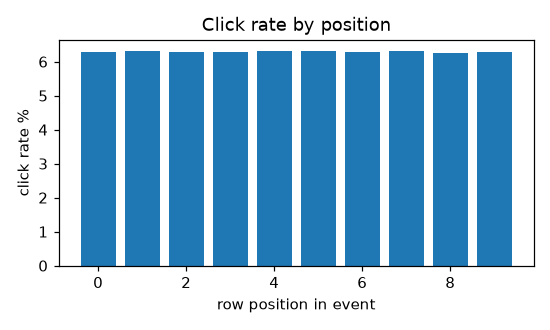
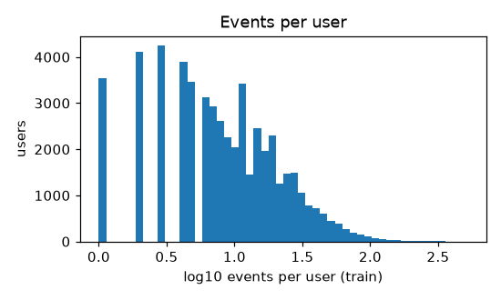
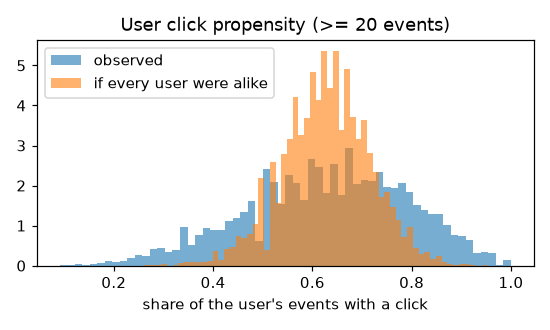
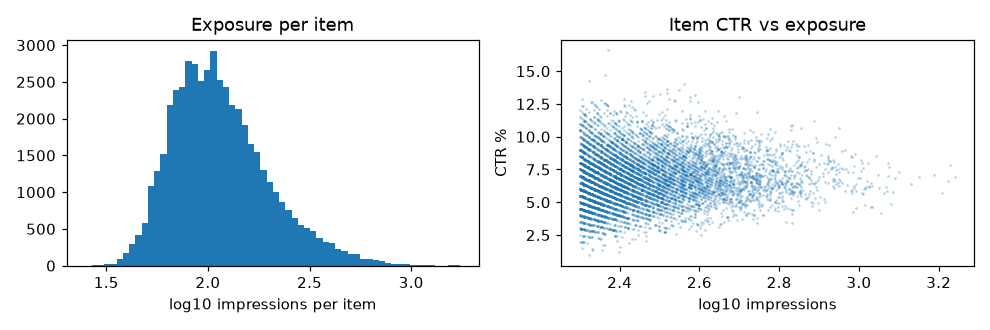
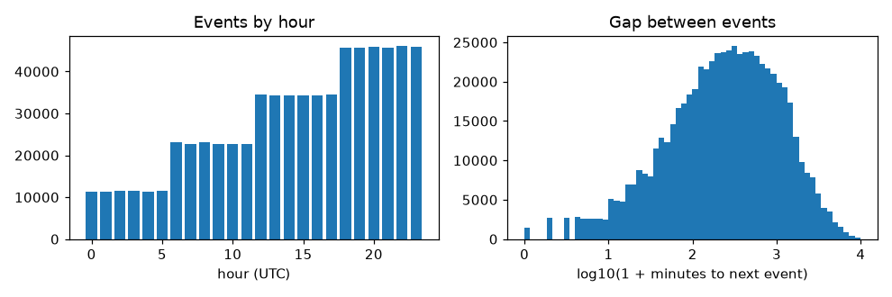
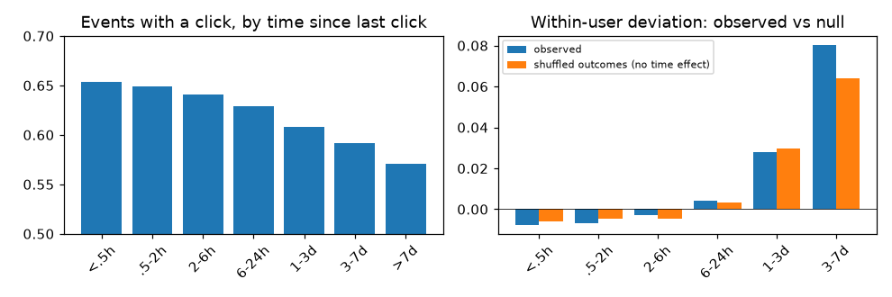
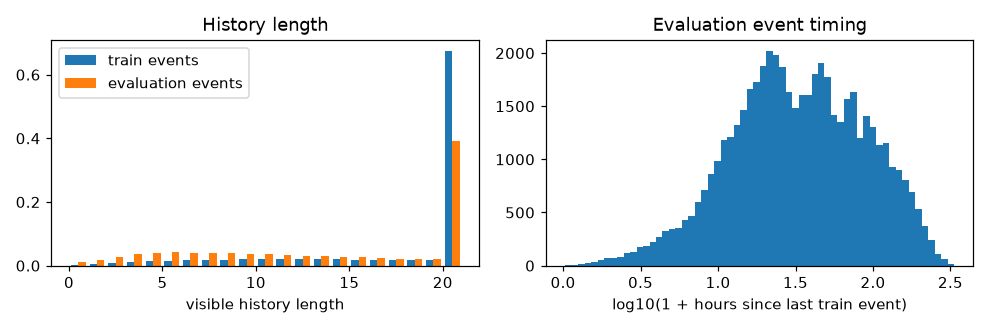

# DATASET.md

What the TechArena Phase 1 data looks like when read raw: structure, integrity, and which
regularities exist (or don't) for a click model. Every number below comes from the scripts listed
under [Reproduce](#reproduce); they read `data/train.csv` and `data/evaluation.csv` directly, with
none of experiment 13's preprocessing.

## Summary

| Question | Answer |
|---|---|
| Are the files clean? | Yes. Every event has exactly 10 contiguous rows that agree on user, time and history; no repeated candidate inside an event; at most one click. |
| Are histories complete between events? | Yes. In 99.7% of consecutive event pairs the next history is exactly the previous history plus its click. Users have no unobserved events. |
| What drives a click? | The user's taste (which items they clicked), a strong per-user click propensity, repeat clicks on items already in the history (about 4x), and a weak item appeal. |
| What does NOT matter? | Position in the event, time of day, weekday vs weekend, time since the last click, being re-shown an item, the day. |
| How does the evaluation set differ? | One event per user (the first after the cutoff): far lighter histories, longer gaps since the user's last activity. Validation must be reweighted to its mix. |

## 1. Files and integrity

| | `train.csv` | `evaluation.csv` |
|---|---|---|
| Rows | 6,868,240 | 529,390 |
| Events | 686,824 | 52,939 (one per user) |
| Users | 53,003 | 52,939 |
| Items | 50,000 (all shown, 49,261 clicked) | 50,000 ids overall across both files |
| Time | 2025-01-20 (Mon) to 01-26 (Sun), days 0-6 | 01-27 (Mon) to 02-02 (Sun), days 7-13 |

- All 10 rows of an event are contiguous and identical in `user_id`, `timestamp`, `time_bucket`,
  `day_type` and both history fields. No event shows the same item twice.
- At most one click per event; **62.9%** of training events have a click (6.29% of rows).
- `time_bucket` always matches the timestamp; `day_type` follows the UTC date.
- Evaluation histories contain no click at or after the cutoff.

## 2. Events and candidates



- **Position carries nothing.** The click rate is 6.25-6.32% at every row position (file order).
- **Days are interchangeable.** About 98,000 events per day; the share with a click is 0.626-0.632.
- **Repeats are the one strong candidate-level signal.** 2.6% of candidates are already in the
  visible history; they are clicked at **29.3%**, against 5.7% for the rest (about 4.1-4.3x after
  adjusting for item popularity).
- **Re-showing is policy, not signal.** 3.4% of candidates were shown to the same user in an
  earlier event, about 8x what random exposure would give, so the candidate generator remembers
  users. But re-shown items outside the history are clicked at exactly their item's usual rate
  (ratio 0.900 vs 0.901 for fresh ones); most of the excess comes from items in the history being
  re-shown. Re-shows are not recent either: median 14 events back, only 6% from the previous event.

## 3. Users




- Activity is very skewed: events per user (train) at the 10/50/90/99th percentiles are 2 / 8 / 29
  / 79, with a maximum of 521.
- **Click propensity is a real, strong user trait.** Among users with at least 20 events, the share
  of their events with a click has a standard deviation of 0.163, against 0.087 if every user were
  alike. About **71%** of the spread between users is real, not chance (true sd about 0.14 around a
  mean of 0.63).

## 4. Items



- Exposure is fairly even: impressions per item at the 1/10/50/90/99th percentiles are 43 / 61 /
  107 / 244 / 554 (Gini 0.33). Every item already appears on day 0; the catalogue is static
  (no item is first shown later, and every evaluation candidate was shown in training).
- **Item appeal is weak.** For items with at least 200 impressions, click rates vary with sd 0.019
  against 0.014 from chance alone, so about 43% of the variation is real. Item click rate alone
  ranks day-6 candidates at AUC 0.528 (and is no better per time bucket or per weekday/weekend).
- Exposure is not driven by appeal: corr(log impressions, click rate) = 0.07. Exposure shares in
  train and evaluation correlate at 0.92.

## 5. Histories

- A history holds up to 20 clicks, oldest first. At the 10/50/90th percentiles training events
  have 8 / 20 / 20 visible clicks; 67.5% are full (20), so older clicks are cut off.
- **47%** of all history entries in training events are clicks from the warm-up period before
  2025-01-20; 76% of histories contain some item more than once.
- **Bookkeeping is exact.** Over 633,821 pairs of a user's consecutive events, the next history equals
  the previous history plus that event's click in 99.73% of cases. Only 0.04% of pairs gain a click
  that no observed event explains, and 0.01% lose one. Users do not have unobserved events between
  the ones in the file, so the click log rebuilt from histories and labels is complete for each user's
  observed period. The only lost information is warm-up clicks older than the first visible 20.

## 6. Time



- Events spread over all 24 hours; the share with a click is 0.620-0.635 in every hour and
  0.629 on weekdays and weekends alike.
- Gaps between a user's consecutive events: 26 min / 4.3 h / 24.7 h at the 10/50/90th
  percentiles; 0.2% are in the same minute.



- **There is no recency or fatigue effect, although the raw data suggests one.** The share of
  events with a click falls from 0.654 (last click under 30 minutes ago) to 0.571 (over a week ago),
  but that is the user: heavy clickers always have a recent click. Within each user, the deviation
  from the user's own rate even turns positive for long gaps (+0.08 at 3-7 days), but a permutation
  null (each user's outcomes shuffled across their own events) produces the same pattern: it is the
  "hot hand" selection bias. Observed minus null is within +-0.002 in every bucket with real mass.
  Time since the previous event is flat as well.

## 7. Evaluation set vs training



| Known clicks per event (up to 100, rebuilt click log) | `evaluation.csv` | train day 6 |
|---|---|---|
| 0 | 1.3% | 0.2% |
| 1-5 | 16.4% | 4.0% |
| 6-20 | 45.0% | 24.2% |
| 21-50 | 33.7% | 54.0% |
| 51-100 | 3.6% | 17.6% |

- Each user appears once, with their first event after the cutoff. Every user counts once, while
  training days are dominated by heavy users, so light users weigh about 4x more in the evaluation.
  Visible histories: 4 / 15 / 20 clicks at the 10/50/90th percentiles (train: 8 / 20 / 20); 1.3%
  are empty. 2.7% of evaluation users have no training events.
- Timing: 67% of evaluation events fall on day 7, then 17%, 7%, 4%, 2%, 2%, 1% on days 8-13. The
  user's last training event was 8 / 31.5 / 121 hours earlier (10/50/90th percentiles), against a
  median 4.3 h between training events. Section 6 shows the gap itself does not change click
  behaviour; it changes who is in the set.

## 8. What this means for modelling

1. **The signal is in three places:** the user's taste as given by the set of clicked items, the
   user's click propensity (real and large), and repeat candidates. Item appeal is a minor fourth.
   The project's MF + LightGBM covers all four (`experiments/RESULTS.md`).
2. **Not worth modelling:** position, hour, weekday, day, recency or fatigue, re-exposure, the
   gap since the last event. All are flat here, and recency only looks real before correcting for
   the user.
3. **No hidden data to recover.** Histories are complete between events. The evaluation histories
   add nothing after the cutoff. The click log rebuilt from histories and training labels is
   everything there is.
4. **Validate on the evaluation's mix.** Reweight validation events by known-clicks bucket (table
   above). `experiments/lab/extra_member.py` does this; the weighted day-6 half B tracks the public
   score to about 0.0003. Plain half B overweights heavy users and overstates the score by about
   0.018.
5. **The remaining headroom is light users.** 61% of evaluation events have 20 or fewer known clicks,
   and their taste must be estimated from a handful of items; per-user propensity for users with
   few events is the other uncertain part.

## Reproduce

```bash
.venv/bin/python experiments/lab/dataset_extract.py        # raw CSVs -> data/cache/dataset_raw.npz (~1 min)
.venv/bin/python experiments/lab/dataset_analysis.py       # numbers (docs/dataset/numbers.json) and figures
.venv/bin/python experiments/lab/dataset_recency_null.py   # permutation null for the recency check
.venv/bin/python experiments/lab/dataset_reshow.py         # re-shown candidates
```

The figures need `matplotlib` (`uv pip install --python .venv/bin/python matplotlib`). Outputs
are logged in `experiments/logs/2026-10-26_lab_dataset_*.txt`. The known-clicks table, the item
click-rate AUC and the context checks come from `experiments/lab/extra_member.py` and the checks in
`experiments/RESULTS.md` (2026-10-25).
